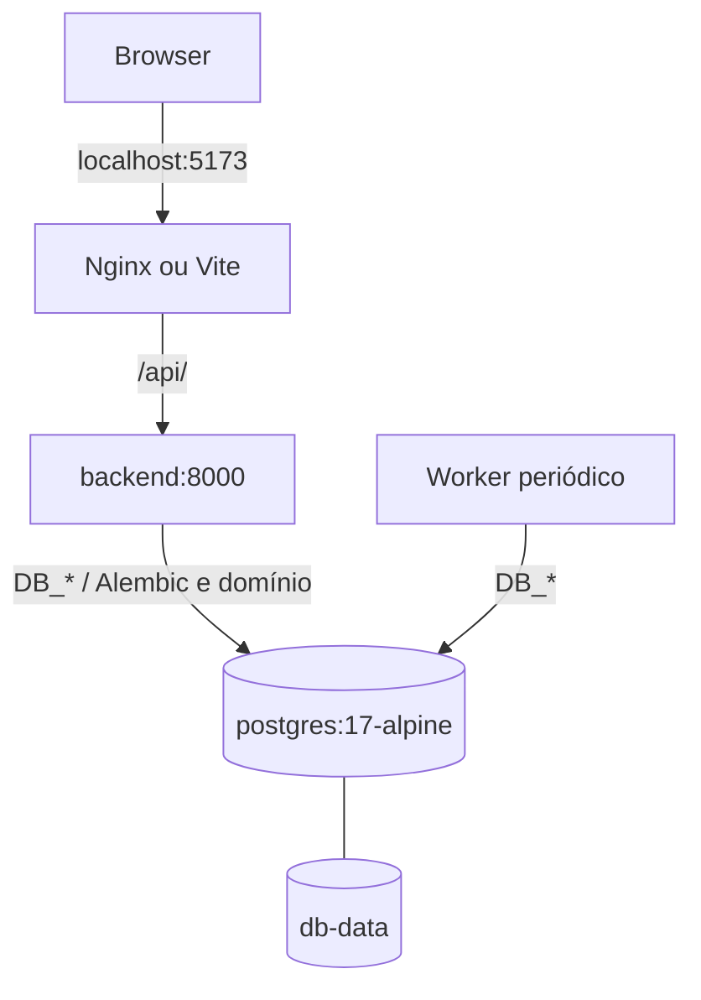
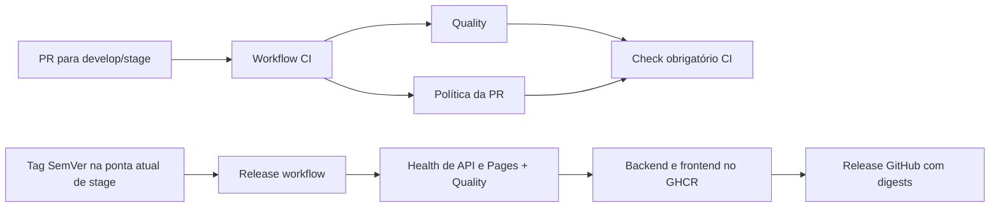

# Infraestrutura e automações

## Visão geral

Esta parte é a montagem do sistema: o Compose liga banco, API e interface no computador do desenvolvedor; os containers empacotam cada aplicação; e o workflow `release.yml` desta mudança verifica e publica imagens quando uma tag SemVer aponta para a ponta validada de `stage`. A ativação depende de integrar a mudança e concluir as configurações externas descritas no [fluxo GitHub](../github-workflow.md). A publicação termina no registry e não instala a aplicação em um servidor de produção.

A direção de operação em LOCAL, DEV, STAGE e PROD, com configurações independentes e rollback, está no [contexto do produto](../product-context.md). A spec 0018 acrescenta stage em Supabase, Render e Cloudflare Pages. Os três serviços estão publicados: API e proxy respondem health 200 com banco saudável. A falha controlada do banco e a recuperação do Render foram verificadas; a ação de rollback reimplantou um deploy anterior do mesmo commit. DEV e PROD não têm implantação configurada.

## Arquivos e responsabilidades

| Arquivo | Papel |
|---|---|
| `docker-compose.yml` | Orquestra PostgreSQL, backend, worker, frontend, migration, portas e volume |
| `.env.example` | Exemplo local de variáveis do Compose |
| `backend/Dockerfile` | Imagem Python 3.13 slim com uv, Alembic, Uvicorn e o script de entrada de stage |
| `backend/start-stage.sh` | Aplica migrations e só então inicia Uvicorn na porta fornecida pelo Render |
| `frontend/Dockerfile` | Build Node 22 e imagem final Nginx 1.27 |
| `frontend/nginx.conf` | Serve SPA e encaminha `/api/` ao backend |
| `render.yaml` | Blueprint do serviço web gratuito de stage, com branch, migration, variáveis e health check |
| `frontend/functions/api/[[path]].ts` | Proxy HTTPS de mesma origem para `/api/*` no Cloudflare Pages |
| `frontend/public/_routes.json` | Invoca a Pages Function somente para `/api/*` |
| `scripts/compose-worktree.ps1` | Isola nome Compose, volume e portas por worktree no Windows |
| `.github/workflows/ci.yml` | Agrega qualidade e política de PR sob check obrigatório `CI` |
| `.github/workflows/quality.yml` | Ruff/pytest/PostgreSQL, lint/test/build React, testes Node gerais e actionlint |
| `.github/workflows/project.yml` | Sincronização opcional com GitHub Project; job `resolve` define a chave de concorrência por Issue |
| `.github/workflows/release.yml` | Em tag `vMAJOR.MINOR.PATCH` validada contra stage, publica imagens e cria release com digests |
| `.github/workflows/validate-mercadolivre-stage.yml` | Execução manual em `develop` para consultar anúncios e validar OAuth no banco Stage; a renovação pode atualizar credenciais |
| `.github/scripts/*.cjs` | Política de PR e integração GraphQL/Project, com testes Node adjacentes |

## Integração de design

A spec 0039 descontinua Paper Bridge e retira do job Automation a instalação
do pacote, a instalação do Chromium e os testes exclusivos da Bridge. Permanecem
os testes Node gerais e actionlint, além dos gates de backend e frontend. O
Playwright de regressão visual da aplicação é preservado e continua separado do
CI, conforme o [guia frontend](frontend.md#testes-e-verificação).

O Figma é consultado pelo MCP oficial autorizado no cliente, sem serviço de
bridge, porta CDP ou container adicional. As convenções e o fallback estão no
[fluxo oficial de design](frontend.md#fluxo-oficial-de-design--figma).
A configuração canônica e suas projeções são descritas no
[setup do harness](../harness-setup.md).
O MCP oficial do Paper permanece configurado para uso eventual, sem reativar
a Bridge ou adicionar automação/porta CDP ao fluxo principal Figma.

Os resultados antigos das specs 0035–0037 são históricos. Para consultar a
implementação removida, use o
[snapshot anterior à retirada](https://github.com/SamiaLuvanice/bestprice/tree/3f230793e6699f16e8443ecad045dc1d13ba3304/tools/paper-bridge).
Capturas, assets, relatórios e worktrees locais de trabalhos anteriores são
preservados; a retirada não inclui limpeza global nem desinstalação do Paper.

## Regras das automações GitHub

| Código | Responsabilidade observada |
|---|---|
| `policy.cjs` — `closingIssue`, `validatePullRequest`, `checkPullRequest` | Exige uma única linha de fechamento `Closes #n`, branch/base válidas, Issue aberta do repositório e referência à Issue nos commits (exceto commits de merge); limita validação a 250 commits |
| `project-state.cjs` — `projectStatus` | Mapeia eventos futuros para Backlog, Ready, In progress, In review, Develop ou Stage; `Released` é preservado pela renomeação da opção histórica `Main`, não é calculado pelo sync. Issue aberta sem responsável e com `specReady` vai a Ready |
| `spec-status.cjs` — `parseFeatureBranch`, `parseSpecStatus`, `specChanged`, `issueSpecState` | Liga `feature/<spec>-issue-<n>-<slug>` à Issue `#n`, lê o `status:` de `specs/<spec>-*/spec.md` no SHA atual de cada branch da Issue e indica se alguma está `pronta`; spec ilegível ou pasta ambígua vira aviso |
| `sync-project.cjs` — função exportada, `pushChangedSpec` e `wasClosedByDefaultBranchPr` | Em push de branch de feature, resolve a Issue pela branch e só segue se a spec da própria branch mudou (primeiro push e force-push contam); busca estado atual do item, preenche `specReady` para Issue aberta, consulta o `ClosedEvent` mais recente da Issue (aceito a até 60 s do `closed_at`), localiza campo/opção Status no Project e atualiza via GraphQL |
| `*.test.cjs` | Exercita regras de PR, mapeamento de status e sincronização com GraphQL simulado |

O sync mantém prioridade e ordenação existentes. Issue aberta sem responsável vai a Ready quando ao menos uma de suas branches de feature tem a spec `pronta` (spec 0014); responsável tem precedência e Issue fechada ignora a spec. Push fora do padrão de branch, sem alteração da spec da branch, para Issue inexistente ou que aponta uma PR não altera o Project nem falha. Issue fechada só vai para Develop quando o evento de fechamento atual aponta para PR mergeada em `develop`; cancelamento como “não planejada” volta a Backlog porque não há opção `Canceled` no conjunto esperado. O Project precisa ter campo `Status` com opções existentes. A integração não cria campo nem opções automaticamente.

## Topologia local

O Compose publica serviços em loopback. As portas padrão são frontend 5173, backend 8000 e DB 5433; internamente, Nginx escuta 80 e PostgreSQL 5432. O healthcheck do banco bloqueia a inicialização do backend até o PostgreSQL responder `pg_isready`. O backend executa `alembic upgrade head` antes de Uvicorn. O worker inicia após o health check HTTP do backend e roda `python -m app.monitoring.worker`; sem a integração autorizada, aguarda sem consultar publicações.

Para as rotas da spec 0021, `frontend/nginx.conf` aplica `try_files $uri $uri/ /index.html` aos caminhos da SPA. `/api/*` permanece no bloco de proxy e não recebe HTML de fallback. Na worktree da feature, `/`, `/login`, `/produtos`, `/produtos/:id`, `/alertas` e uma rota desconhecida responderam HTTP 200 no Nginx local; a aplicação React apresenta a tela ou o estado 404 conforme a URL e a sessão. O health da API retornou 200 com PostgreSQL, 503 durante uma parada controlada do banco local e 200 após restaurá-lo. A abertura direta e a recarga desta revisão no Cloudflare Pages de `stage` ainda precisam de validação após promoção; a configuração de stage existente não demonstra a nova revisão.

## Variáveis do Compose e worktree

As variáveis da aplicação estão tabeladas em [architecture.md](../architecture.md#estado-desta-branch). `.env.example` inclui `MERCADOLIVRE_THIRD_PARTY_VALIDATED=false`, variáveis OAuth/chave Fernet e URI de callback, três IDs MLB para a sonda, `APP_ENV=development` e cinco parâmetros `MONITOR_*`. Compose repassa OAuth, callback, IDs de validação e `MONITOR_*` a backend e worker. A configuração Render define o callback HTTPS Stage, mas não configura segredos. Para iniciar a autorização, `python -m app.marketplace.authorize_operator` imprime uma URL oficial; a aplicação precisa estar criada no DevCenter, e a mesma chave Fernet deve estar segura no ambiente que inicia o fluxo e em Stage. A versão com diagnóstico por categorias seguras foi promovida pela PR #139; o serviço Render está Live com health 200. Após três tentativas malsucedidas, a quarta autorização foi concluída e a persistência cifrada confirmada por contagem e validade, sem ler tokens. A autorização inicial foi demonstrada, mas a renovação e a consulta de anúncios ainda não. O último valor conhecido da flag Stage era `false`; a sincronização pela PR #144 não alterou variáveis de ambiente, mas o valor não foi relido após a integração. A ferramenta `python -m app.marketplace.validate_live --confirm-live-requests`, em `backend/`, usa os IDs de cenário e o banco local, consulta até três anúncios em modo de leitura (até dois GETs por anúncio) e só confirma sucesso após observar uma rotação real do token e os três resultados esperados. Os IDs não são segredos, mas precisam ser anúncios de terceiros permitidos à conta operadora. Mantenha o flag desligado até validar renovação, anúncios permitidos e limites operacionais; não provoque 429 e use dublês para validar falhas e recuperação. Os valores de monitoramento devem ser escolhidos conforme os limites oficiais validados; os padrões atuais permitem testar a operação local. O script de worktree também lê `BACKEND_PORT`, `FRONTEND_PORT` e `DB_PORT` do ambiente do PowerShell como overrides. Na ausência delas, deriva valores estáveis de branch e caminho, em faixas distintas; valida o intervalo `1..65535`; então restaura os valores de ambiente anteriores ao terminar.

O isolamento de projeto cria nomes e volumes distintos por worktree. As portas ainda podem conflitar com outro processo. O script não cria senhas próprias: Compose continua exigindo `POSTGRES_PASSWORD` em `.env` ou no ambiente.

## Operação local da assistência — spec 0034

Compose repassa `AI_ENABLED` (padrão `false`) e `GEMINI_API_KEY` (padrão vazio)
apenas ao backend. A chave não vai para o bundle da SPA. A configuração opt-in
não provisiona conta, faturamento ou segredo remoto, nem ativa monitoramento MLB.
O modelo e as cotas locais estão no [guia backend](backend.md#assistência-e-pesquisas-privadas--spec-0034).
A gratuidade depende da configuração Google da pessoa operadora; o app não audita
billing e a validação externa permanece pendente.

`frontend/nginx.conf` permite `proxy_read_timeout 35s` somente para
`/api/ai/chat` e `/api/comparisons/{id}/analyze`, acima dos 25 s do adapter Google.
O restante de `/api/` mantém 5 s de leitura; conexão usa 2 s e envio 5 s em ambos.
O proxy de desenvolvimento Vite aceita `API_PROXY_TARGET`, com padrão
`http://localhost:8000`, para uma API isolada da worktree. Essa variável não
configura a Pages Function nem representa verificação do proxy Stage.

A migration local passa a `20261026research` e deve ser aplicada antes de servir
a revisão 0034. As seis tabelas research recebem RLS; o head conhecido de Stage
na evidência histórica abaixo continua separado da nova revisão. O lifespan da
API agenda limpeza física horária de pesquisas; não é tarefa do worker de MLB.
Com a API parada, não há limpeza periódica, mas leituras negam registros vencidos
assim que o serviço retorna. Para executar manualmente:
`docker compose run --rm backend python -m app.research.cleanup` ou, em
`backend/` com o banco configurado, `uv run python -m app.research.cleanup`.

SPA, API e PostgreSQL foram exercitados localmente com o schema final; apenas a
fronteira de geração externa usou fixture e o adapter Google foi bloqueado para
rede real. Não houve chave, custo, alteração de Stage ou promoção nesta tarefa.
As rotas `/app/*` e os aliases anteriores dependem do mesmo fallback SPA; os
testes locais não comprovam abertura direta dessa revisão no deploy público.

## Sonda oficial do Mercado Livre no GitHub Actions

O Render Free não disponibiliza Shell nem One-off Jobs. Após o workflow ser
integrado em `develop`, a sonda existente em `backend/app/marketplace/validate_live.py`
pode ser executada sem custo no runner hospedado pelo GitHub. Ela consulta
anúncios permitidos pela conta operadora e pode renovar/persistir o refresh token
OAuth no banco Stage; não escreve produtos e não altera
`MERCADOLIVRE_THIRD_PARTY_VALIDATED`.

Na configuração do repositório, crie o GitHub Environment `stage-validation` e
restrinja os deployments ao branch `develop`. Cadastre nele, como secrets, os
valores copiados dos respectivos campos do Render Stage:

| Secret no GitHub | Variável de origem no Render |
|---|---|
| `STAGE_DATABASE_URL` | `DATABASE_URL` |
| `STAGE_MERCADOLIVRE_OAUTH_KEY` | `MERCADOLIVRE_OAUTH_KEY` |
| `STAGE_MERCADOLIVRE_CLIENT_ID` | `MERCADOLIVRE_CLIENT_ID` |
| `STAGE_MERCADOLIVRE_CLIENT_SECRET` | `MERCADOLIVRE_CLIENT_SECRET` |

Não registre os valores em arquivos, Issue, PR, console ou artefatos. Quem tem
permissão de escrita no repositório pode alterar workflows; mantenha a proteção
de `develop` e revise os diffs de Actions antes de integrar.

No GitHub, abra **Actions → Validate Mercado Livre Stage → Run workflow**,
selecione `develop` e informe IDs MLB distintos para preço, sem preço e
indisponível. A sonda valida formato e unicidade antes de qualquer chamada e
imprime somente o relatório sanitizado com status, códigos, IDs e dados mínimos
de preço/disponibilidade. A ausência de anúncio naturalmente sem preço é uma
ação manual a registrar, não uma razão para substituir preço ausente por zero.
Não repita uma tentativa OAuth de resultado incerto: o refresh token anterior é
de uso único e o token rotacionado fica persistido no Stage.

Uma execução `passed` é evidência para a decisão operacional 0026, não uma
ativação automática. Depois da validação, remova os secrets do environment caso
não seja necessário repetir a sonda; o workflow pode ser reutilizado após
recadastrar os secrets. Ative o gate no Render somente após revisar a evidência
e confirmar os limites oficiais aplicáveis.

No relatório, um HTTP 403 mantém `error_code: integration_access_denied` e
acrescenta `blocked_resource: item` ou `blocked_resource: sale_price`, conforme
a leitura negada. Essa informação curta ajuda a direcionar a revisão do
DevCenter sem registrar o caminho com ID, resposta bruta, cabeçalhos ou dados do
anúncio. Ela não indica, por si só, qual permissão ou política precisa mudar.

## CI e entrega

Quality usa Python 3.13 e PostgreSQL 17 para testes do backend; Node 22 para lint, testes e build do frontend; testes `node --test .github/scripts/*.test.cjs`; e actionlint. O workflow `CI` é o check agregado exigido e falha se algum gate necessário falhar ou for cancelado.

Em tags `vMAJOR.MINOR.PATCH`, `release.yml` exige que a tag existente aponte para o SHA da ponta atual de `stage`, valida health da API Render e do Pages, executa Quality e publica as duas imagens no GHCR com tags da versão e SHA. Tags `build-*` não disparam releases. Gera SBOM/proveniência e cria release contendo os digests das imagens. Imagens Linux são montadas para o ambiente padrão do workflow. Uma falha parcial pode deixar uma imagem publicada sem release completa.

## Integrações operacionais

`project.yml` reage a eventos de Issues e PRs, a push em `feature/**` que altera `specs/*/spec.md` e a execução manual, e pode atualizar um GitHub Project. O job `resolve` calcula a chave (número da Issue, extraído da branch no push) e o job `sync` usa o grupo de concorrência `project-<chave>`, serializando push e eventos da mesma Issue. Sem `PROJECT_TOKEN`, emite aviso e encerra como não sincronizado; `PROJECT_OWNER` e `PROJECT_NUMBER` identificam o Project quando configurado. O token não é passado a código da cabeça da PR: o workflow faz checkout da branch padrão. No gatilho `push`, os scripts também vêm da branch padrão e a spec é lida pela API como dado, mas o YAML do workflow vem da branch publicada; só colaboradores com escrita publicam branches.

O script configure-github.ps1 aplica as proteções de develop e stage: PR, CI e conversas resolvidas, sem exclusão nem force push e sem aprovação humana obrigatória para o fluxo solo. Detalhes de permissões e reconciliação estão em [github-workflow.md](../github-workflow.md).

## Stage preparado pela spec 0018

O [Blueprint `render.yaml`](../../render.yaml) declara `bestprice-stage-api` como serviço web Docker `free` na região `virginia`, ligado à branch `stage`. `autoDeployTrigger: checksPass` solicita implantação após os checks dessa revisão, e `healthCheckPath: /api/health` só passa quando a API consulta o banco. `dockerCommand` chama `/app/start-stage.sh`, copiado e marcado como executável pelo Dockerfile. O script executa `alembic upgrade head` e, se tiver êxito, inicia Uvicorn na porta `PORT` fornecida pelo Render (padrão 10000). Migration ou conexão malsucedida impede a API de iniciar. O arquivo não cria banco Render nem worker. O deploy #69 ficou Live e aplicou as migrations até `20261014rls`.

O Blueprint estava com **Auto Sync** ativado e iniciou a implantação da promoção #67 antes do término do CI da mesma revisão. Em 14/10/2026, Auto Sync foi alterado para **No** no painel do Blueprint; o serviço continuou configurado com **Auto-Deploy: After CI Checks Pass**. Na promoção #69, sem alteração em `render.yaml`, o CI de `stage` terminou às 16:42:07 UTC e o deploy automático Render iniciou às 16:42:09 UTC. O rollback Render exercitado antes dessa promoção desativou Auto-Deploy; a opção **After CI Checks Pass** foi restaurada no painel. Alterações futuras em `render.yaml` exigem sincronização manual do Blueprint, depois dos checks e da revisão. Não acione a sincronização durante CI pendente.

Para reproduzir a configuração e concluir a validação, confira os controles de cobrança dos três provedores:

1. O projeto **Supabase Free exclusivo de stage** `bestprice-stage` foi criado em `sa-east-1` (ref `nhqlkqgliofpesfslozb`); o custo informado na criação foi 0/mês. O painel confirmou compute Nano a US$ 0/h, add-ons desativados e spend cap habilitado. A URL PostgreSQL do **Session pooler**, porta 5432, exige TLS com `sslmode=require` e fica somente como segredo `DATABASE_URL` no Render; não a registre no repositório, em logs ou no Pages. O health público comprova a conexão de banco da API. As dez tabelas `public` tiveram RLS habilitado diretamente no stage com aprovação do responsável e a migration `20261014rls` aplicou a mesma proteção no deploy #69. O head foi confirmado; 10/10 tabelas estão protegidas, sem políticas de acesso direto por `anon` ou `authenticated`.
2. O serviço Render foi vinculado ao repositório pelo Blueprint da branch `stage`. O painel mostra serviço `free`, branch `stage`, `Auto-Deploy: After CI Checks Pass`, health `/api/health`, `APP_ENV=stage` e `DATABASE_URL` como segredo. O último valor conhecido de `MERCADOLIVRE_THIRD_PARTY_VALIDATED` no painel foi `false`; não houve alteração de ambiente na sincronização da PR #144 e o valor não foi relido depois. O `sync: false` do Blueprint exige preencher `DATABASE_URL` no painel. A correção de start chegou a Live; confira a revisão Alembic e o health em cada promoção.
3. O projeto **Cloudflare Pages Free** foi criado e publicou a interface. Confirme `frontend/` como diretório raiz, `npm ci && npm run build` como comando, `dist` como saída e `stage` como branch de produção do projeto Pages. `API_ORIGIN` no ambiente de produção deve ser a origem HTTPS da API Render, sem caminho, credenciais, consulta ou barra de rota (exemplo: `https://bestprice-stage-api.onrender.com`). A Function encaminha `/api/*`; os arquivos estáticos não consomem a cota de Function.
4. As promoções `develop` → `stage` #62, #67 e #69 ocorreram por PR com CI verde. Após #69, Render e Pages publicaram `0b5aea4` e o endereço Pages retornou `GET /api/health` 200 com `status` e `database` iguais a `ok`. Login de uma conta QA descartável via Pages antes de #69 emitiu cookie `Secure`, `HttpOnly`, `SameSite=Lax` e `Path=/api`; a conta e a sessão QA foram apagadas. Em cada promoção, confira o health e a revisão Alembic sem imprimir a URL do banco.

O fluxo de rollback operacional é selecionar no Render o último deploy de API compatível e, se a interface mudou, restaurar no Pages o deploy compatível; registre SHAs e resultados de health. Antes da migration RLS, a ação de rollback do Render reimplantou um deploy anterior **do mesmo commit #67 (`7639d85`)**: ficou Live e o health direto/via Pages retornou 200. Isso exercitou o controle e a recuperação operacional, sem testar troca entre versões de código. O rollback Pages também não foi testado. A ação no Render desativa Auto-Deploy: restaure **After CI Checks Pass** no painel e confira antes da próxima promoção. Migrações já aplicadas não são revertidas automaticamente. **Após `20261014rls`, não selecione #67 como rollback**, pois o código antigo não conhece o novo head Alembic. Se esquema ou dados não forem compatíveis, planeje a correção antes de trocar o tráfego.

O limite de gasto precisa ser conferido nos **painéis e na conta** antes de criar recursos: Render `free` sozinho não impede cobrança de banda de saída ou minutos de build excedentes quando há forma de pagamento; limite do pipeline não cobre toda a banda. A conta Render usada para stage não tinha cartão em 13/10/2026. Segundo a [documentação do Render](https://render.com/docs/free#bandwidth-and-build-pipeline), sem forma de pagamento o excesso de banda suspende os serviços Free e o excesso de minutos interrompe novos builds, em vez de gerar cobrança. Mantenha apenas instâncias Free e não cadastre pagamento sem reavaliar o controle de custo. No Supabase Free, o banco tem limite operacional de 500 MB e pode ficar somente leitura; projetos pouco ativos podem pausar. Render Free pode hibernar após inatividade. A Pages Function consome a cota Free de Workers; esgotá-la pode interromper `/api/*`. Cotas e controles reais estão na [verificação 0018](../../specs/0018-backend-stage-render-supabase/verification.md); nenhum desses controles garante disponibilidade contínua.

O comportamento **local** da preparação inicial foi verificado: Ruff; 149 testes backend com PostgreSQL 17 isolado; lint, 255 testes e build frontend; 43 testes Node; migration no head e health 200 pela API/proxy Compose, 503 sem banco. A PR [#68](https://github.com/SamiaLuvanice/bestprice/pull/68) integrou a migration RLS com CI de **154 testes backend** em PostgreSQL; [#69](https://github.com/SamiaLuvanice/bestprice/pull/69) promoveu `stage` (`0b5aea4`). O CI terminou às 16:42:07 UTC, o deploy Render iniciou às 16:42:09 UTC, ficou Live e aplicou `20261014rls`; Pages publicou a mesma revisão. O projeto Pages [bestprice-stage.pages.dev](https://bestprice-stage.pages.dev) e a API Render Free [bestprice-stage-api.onrender.com](https://bestprice-stage-api.onrender.com) respondem health 200 com banco `ok`, diretamente e pelo proxy. Pausar o Supabase fez a API retornar 503 seguro; Events do Render registrou health check 503, seguido de 502 na borda. O restore recuperou o serviço e o health 200. Antes da migration, a ação de rollback Render reimplantou deploy anterior do mesmo commit #67 e ficou Live com health 200. Os painéis confirmaram Render Hobby sem cartão e pipeline limitado a US$ 0, Cloudflare Workers Free sem forma de pagamento e Supabase Free com spend cap. Stage não inclui o worker periódico e mantém a integração Mercado Livre desabilitada.

## Operação diária

- Subir stack: `docker compose up --build`.
- Parar mantendo dados: `docker compose down`.
- Banco isolado: `docker compose up -d db`.
- Worktree Windows: `./scripts/compose-worktree.ps1 up --build` e `./scripts/compose-worktree.ps1 down`.
- Consultar logs: `docker compose logs -f db backend worker frontend`.
- Publicação: ocorre por tag SemVer na ponta validada de `stage`; não é implantação em cloud.

## Pegadinhas e dívidas

- `depends_on` do frontend apenas ordena inicialização; o backend tem healthcheck HTTP em `/api/health` para iniciar o worker.
- `docker compose down` preserva `db-data`; `down -v` remove o volume e seus dados.
- O backend espera banco healthy e aplica as migrations antes de iniciar. A stack isolada `bestprice0013verify` foi reconstruída: revisão `20261009safe`, health da API e worker aguardando autorização foram conferidos. Pelo proxy Nginx, login retornou 200, URL inválida 400 e anúncio novo sem integração 503. Esses testes não cobriram OAuth real, consulta ao Mercado Livre nem navegação visual; veja [verification.md](../../specs/0013-monitoramento-mercado-livre-brasil/verification.md).
- O frontend de container é uma imagem Nginx; o modo de desenvolvimento usa Vite e proxy próprio.
- O primeiro deploy público da API falhou, mas #67 corrigiu o start e #69 aplicou RLS após os checks. Health, proxy, cookie, falha de banco, recuperação e ação de rollback do Render foram conferidos nos limites da [verificação 0018](../../specs/0018-backend-stage-render-supabase/verification.md). Reversão entre versões e rollback Pages não foram testados. DEV e PROD seguem sem implantação configurada.
- Sincronização do GitHub Project depende de `PROJECT_TOKEN`, `PROJECT_OWNER` e `PROJECT_NUMBER`, registrados como configurados em [github-workflow.md](../github-workflow.md#configurar-o-project-permissão-adicional); confirme pela execução do workflow antes de afirmar que um evento chegou ao board.
- O Ready automático da 0014 foi observado no Project real após o merge em `develop`: a V04 registrou a Issue #43 em `Ready` após push da spec `pronta` e novamente após remover o responsável (ver [verification.md](../../specs/0014-project-ready-automatico/verification.md)). Remover a branch não dispara sincronização; o Status é recalculado no próximo evento da Issue.
- Dockerfiles usam versões fixas ou major/minor específicas em imagens base; dependências externas e Actions fixadas precisam de manutenção periódica.
