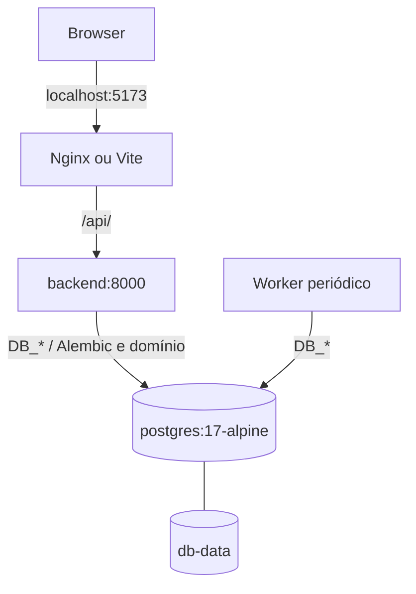
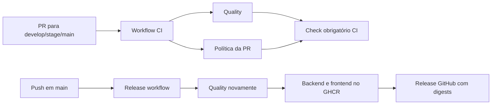

# Infraestrutura e automações

## Visão geral

Esta parte é a montagem do sistema: o Compose liga banco, API e interface no computador do desenvolvedor; os containers empacotam cada aplicação; e o GitHub Actions verifica as mudanças e publica imagens quando chegam à branch `main`. A publicação termina no registry e não instala a aplicação em um servidor de produção.

A direção de operação em LOCAL, DEV, STAGE e PROD, com configurações independentes e rollback, está no [contexto do produto](../product-context.md). A spec 0018 acrescenta a configuração de stage em Render e Cloudflare Pages, mas os projetos públicos ainda não foram criados. DEV e PROD também não têm implantação configurada. Branches de promoção não equivalem a ambientes provisionados.

## Arquivos e responsabilidades

| Arquivo | Papel |
|---|---|
| `docker-compose.yml` | Orquestra PostgreSQL, backend, worker, frontend, migration, portas e volume |
| `.env.example` | Exemplo local de variáveis do Compose |
| `backend/Dockerfile` | Imagem Python 3.13 slim com uv, Alembic e Uvicorn |
| `frontend/Dockerfile` | Build Node 22 e imagem final Nginx 1.27 |
| `frontend/nginx.conf` | Serve SPA e encaminha `/api/` ao backend |
| `render.yaml` | Blueprint do serviço web gratuito de stage, com branch, migration, variáveis e health check |
| `frontend/functions/api/[[path]].ts` | Proxy HTTPS de mesma origem para `/api/*` no Cloudflare Pages |
| `frontend/public/_routes.json` | Invoca a Pages Function somente para `/api/*` |
| `scripts/compose-worktree.ps1` | Isola nome Compose, volume e portas por worktree no Windows |
| `.github/workflows/ci.yml` | Agrega qualidade e política de PR sob check obrigatório `CI` |
| `.github/workflows/quality.yml` | Ruff/pytest/PostgreSQL, lint/test/build React, Node tests e actionlint |
| `.github/workflows/project.yml` | Sincronização opcional com GitHub Project; job `resolve` define a chave de concorrência por Issue |
| `.github/workflows/release.yml` | Em `main`, publica imagens e cria release com digests |
| `.github/scripts/*.cjs` | Política de PR e integração GraphQL/Project, com testes Node adjacentes |

### Regras das automações GitHub

| Código | Responsabilidade observada |
|---|---|
| `policy.cjs` — `closingIssue`, `validatePullRequest`, `checkPullRequest` | Exige uma única linha de fechamento `Closes #n`, branch/base válidas, Issue aberta do repositório e referência à Issue nos commits (exceto commits de merge); limita validação a 250 commits |
| `project-state.cjs` — `projectStatus` | Mapeia Issue/PR para Backlog, Ready, In progress, In review, Develop, Stage ou Main; Issue aberta sem responsável e com `specReady` vai a Ready |
| `spec-status.cjs` — `parseFeatureBranch`, `parseSpecStatus`, `specChanged`, `issueSpecState` | Liga `feature/<spec>-issue-<n>-<slug>` à Issue `#n`, lê o `status:` de `specs/<spec>-*/spec.md` no SHA atual de cada branch da Issue e indica se alguma está `pronta`; spec ilegível ou pasta ambígua vira aviso |
| `sync-project.cjs` — função exportada, `pushChangedSpec` e `wasClosedByDefaultBranchPr` | Em push de branch de feature, resolve a Issue pela branch e só segue se a spec da própria branch mudou (primeiro push e force-push contam); busca estado atual do item, preenche `specReady` para Issue aberta, consulta o `ClosedEvent` mais recente da Issue (aceito a até 60 s do `closed_at`), localiza campo/opção Status no Project e atualiza via GraphQL |
| `*.test.cjs` | Exercita regras de PR, mapeamento de status e sincronização com GraphQL simulado |

O sync mantém prioridade e ordenação existentes. Issue aberta sem responsável vai a Ready quando ao menos uma de suas branches de feature tem a spec `pronta` (spec 0014); responsável tem precedência e Issue fechada ignora a spec. Push fora do padrão de branch, sem alteração da spec da branch, para Issue inexistente ou que aponta uma PR não altera o Project nem falha. Issue fechada só vai para Develop quando o evento de fechamento atual aponta para PR mergeada em `develop`; cancelamento como “não planejada” volta a Backlog porque não há opção `Canceled` no conjunto esperado. O Project precisa ter campo `Status` com opções existentes. A integração não cria campo nem opções automaticamente.

## Topologia local

O Compose publica serviços em loopback. As portas padrão são frontend 5173, backend 8000 e DB 5433; internamente, Nginx escuta 80 e PostgreSQL 5432. O healthcheck do banco bloqueia a inicialização do backend até o PostgreSQL responder `pg_isready`. O backend executa `alembic upgrade head` antes de Uvicorn. O worker inicia após o health check HTTP do backend e roda `python -m app.monitoring.worker`; sem a integração autorizada, aguarda sem consultar publicações.

## Variáveis do Compose e worktree

As variáveis da aplicação estão tabeladas em [architecture.md](../architecture.md#estado-desta-branch). `.env.example` inclui `MERCADOLIVRE_THIRD_PARTY_VALIDATED=false`, variáveis de cliente OAuth e chave Fernet vazias, `APP_ENV=development` e cinco parâmetros `MONITOR_*` de cadência, frescor, lote, concorrência e pausa. Compose repassa OAuth e `MONITOR_*` a backend e worker; não inicia autorização OAuth nem provisiona tokens. A renovação está implementada, mas ainda precisa de validação com a API oficial e a permissão para anúncios de terceiros continua sem prova. Os valores de monitoramento devem ser escolhidos conforme os limites oficiais validados; os padrões atuais permitem testar a operação local. O script de worktree também lê `BACKEND_PORT`, `FRONTEND_PORT` e `DB_PORT` do ambiente do PowerShell como overrides. Na ausência delas, deriva valores estáveis de branch e caminho, em faixas distintas; valida o intervalo `1..65535`; então restaura os valores de ambiente anteriores ao terminar.

O isolamento de projeto cria nomes e volumes distintos por worktree. As portas ainda podem conflitar com outro processo. O script não cria senhas próprias: Compose continua exigindo `POSTGRES_PASSWORD` em `.env` ou no ambiente.

## CI e entrega

Quality usa Python 3.13 e PostgreSQL 17 para testes do backend; Node 22 para lint, testes e build do frontend; testes `node --test .github/scripts/*.test.cjs`; e actionlint. O workflow `CI` é o check agregado exigido e falha se algum gate necessário falhar ou for cancelado.

Em `main`, `release.yml` cria ou valida uma tag `build-<sha12>` ou uma versão `vMAJOR.MINOR.PATCH`, executa Quality e publica as duas imagens no GHCR com tags da versão e SHA. Gera SBOM/proveniência e cria release contendo os digests das imagens. Imagens Linux são montadas para o ambiente padrão do workflow. Uma falha parcial pode deixar uma imagem publicada sem release completa.

## Integrações operacionais

`project.yml` reage a eventos de Issues e PRs, a push em `feature/**` que altera `specs/*/spec.md` e a execução manual, e pode atualizar um GitHub Project. O job `resolve` calcula a chave (número da Issue, extraído da branch no push) e o job `sync` usa o grupo de concorrência `project-<chave>`, serializando push e eventos da mesma Issue. Sem `PROJECT_TOKEN`, emite aviso e encerra como não sincronizado; `PROJECT_OWNER` e `PROJECT_NUMBER` identificam o Project quando configurado. O token não é passado a código da cabeça da PR: o workflow faz checkout da branch padrão. No gatilho `push`, os scripts também vêm da branch padrão e a spec é lida pela API como dado, mas o YAML do workflow vem da branch publicada; só colaboradores com escrita publicam branches. Detalhes de permissões e reconciliação estão em [github-workflow.md](../github-workflow.md).

## Stage preparado pela spec 0018

O [Blueprint `render.yaml`](../../render.yaml) declara `bestprice-stage-api` como serviço web Docker `free` na região `virginia`, ligado à branch `stage`. `autoDeployTrigger: checksPass` solicita implantação após os checks dessa revisão, e `healthCheckPath: /api/health` só passa quando a API consulta o banco. O comando de inicialização executa `alembic upgrade head` antes de iniciar Uvicorn na porta `PORT` fornecida pelo Render (padrão 10000). Migration ou conexão malsucedida impede a API de iniciar. O arquivo não cria banco Render nem worker.

Para provisionar stage, depois de conferir os controles de cobrança dos três provedores:

1. Crie um projeto **Supabase Free exclusivo de stage**. Escolha região e compute incluídos no plano, sem add-ons. Copie a string PostgreSQL do **Session pooler**, porta 5432, e exija TLS com `sslmode=require`. Guarde a URL somente como segredo `DATABASE_URL` no Render; não a registre no repositório, em logs ou no Pages.
2. Vincule o repositório ao Render pelo Blueprint da branch `stage`. Confirme serviço `free`, branch `stage`, checks exigidos, `APP_ENV=stage`, `MERCADOLIVRE_THIRD_PARTY_VALIDATED=false`, `DATABASE_URL` configurada no painel e ausência de recursos pagos. O `sync: false` do Blueprint exige preencher `DATABASE_URL` no painel. Confira nos logs que Alembic chegou ao head e que a instância ficou saudável antes de aceitar a revisão.
3. Crie projeto **Cloudflare Pages Free** ligado ao repositório. Use `frontend/` como diretório raiz, `npm ci && npm run build` como comando, `dist` como saída e `stage` como branch de produção do projeto Pages. Defina `API_ORIGIN` no ambiente de produção do Pages com a origem HTTPS da API Render, sem caminho, credenciais, consulta ou barra de rota (exemplo: `https://bestprice-stage-api.onrender.com`). A Function encaminha `/api/*`; os arquivos estáticos não consomem a cota de Function.
4. Após integrar a feature em `develop`, promova `develop` → `stage` por PR com CI e revisão, conforme [fluxo GitHub](../github-workflow.md). Confira no endereço HTTPS do Pages `GET /api/health`, login, `Secure` e `HttpOnly` no cookie, e a revisão implantada no Render. Confirme a revisão Alembic de forma segura, sem imprimir a URL do banco. Repita após uma promoção posterior para verificar a atualização isolada de `stage`.

O fluxo de rollback operacional é selecionar no Render o último deploy de API compatível e restaurar no Pages o deploy da mesma revisão da interface; registre SHAs e resultados de health. Migrações já aplicadas não são revertidas automaticamente por esse processo. Se o esquema ou os dados não forem compatíveis com a revisão anterior, planeje a correção do banco antes de trocar o tráfego. Esse procedimento ainda precisa ser exercitado nos serviços reais.

O limite de gasto precisa ser conferido nos **painéis e na conta** antes de criar recursos: Render `free` sozinho não impede cobrança de banda de saída ou minutos de build excedentes quando há forma de pagamento; limite do pipeline não cobre toda a banda. Confirme ausência de forma de pagamento ou bloqueio efetivo de excedentes, além de plano e add-ons gratuitos em Render, Supabase e Cloudflare. No Supabase Free, o banco tem limite operacional de 500 MB e pode ficar somente leitura; projetos pouco ativos podem pausar. Render Free pode hibernar após inatividade. A Pages Function consome a cota Free de Workers; esgotá-la pode interromper `/api/*`. Cotas e controles reais devem ser registrados na [verificação 0018](../../specs/0018-backend-stage-render-supabase/verification.md), sem assumir disponibilidade contínua ou custo zero a partir do YAML.

No momento, somente o comportamento **local** foi verificado: Ruff; 149 testes backend com PostgreSQL 17 isolado; lint, 255 testes e build frontend; 43 testes Node; migration no head e health 200 pela API/proxy Compose, 503 sem banco. A PR [#61](https://github.com/SamiaLuvanice/bestprice/pull/61) está aberta para `develop`, com CI, Backend, Frontend, Automation, PR policy, sync e resolve verdes no commit `a03fa8e`; revisão de arquitetura sem achado de código e QA da preparação local aceito com ressalva. Não há aprovação humana no GitHub, merge, projeto público, deploy ou conferência dos painéis registrados. A configuração de stage não inclui o worker periódico e mantém a integração Mercado Livre desabilitada.

## Operação diária

- Subir stack: `docker compose up --build`.
- Parar mantendo dados: `docker compose down`.
- Banco isolado: `docker compose up -d db`.
- Worktree Windows: `./scripts/compose-worktree.ps1 up --build` e `./scripts/compose-worktree.ps1 down`.
- Consultar logs: `docker compose logs -f db backend worker frontend`.
- Publicação: ocorre no fluxo de promoção e merge em `main`; não é implantação em cloud.

## Pegadinhas e dívidas

- `depends_on` do frontend apenas ordena inicialização; o backend tem healthcheck HTTP em `/api/health` para iniciar o worker.
- `docker compose down` preserva `db-data`; `down -v` remove o volume e seus dados.
- O backend espera banco healthy e aplica as migrations antes de iniciar. A stack isolada `bestprice0013verify` foi reconstruída: revisão `20261009safe`, health da API e worker aguardando autorização foram conferidos. Pelo proxy Nginx, login retornou 200, URL inválida 400 e anúncio novo sem integração 503. Esses testes não cobriram OAuth real, consulta ao Mercado Livre nem navegação visual; veja [verification.md](../../specs/0013-monitoramento-mercado-livre-brasil/verification.md).
- O frontend de container é uma imagem Nginx; o modo de desenvolvimento usa Vite e proxy próprio.
- A configuração de stage ainda não foi implantada; não há HTTPS público comprovado, credenciais de stage, migração em Supabase ou rollback exercitado. DEV e PROD seguem sem implantação configurada.
- Sincronização do GitHub Project depende de `PROJECT_TOKEN`, `PROJECT_OWNER` e `PROJECT_NUMBER`, registrados como configurados em [github-workflow.md](../github-workflow.md#configurar-o-project-permissão-adicional); confirme pela execução do workflow antes de afirmar que um evento chegou ao board.
- O Ready automático da 0014 ainda não foi observado no Project real: o gatilho `push` só usa os scripts novos após o merge em `develop` (V04 pendente em [verification.md](../../specs/0014-project-ready-automatico/verification.md)). Remover a branch não dispara sincronização; o Status é recalculado no próximo evento da Issue.
- Dockerfiles usam versões fixas ou major/minor específicas em imagens base; dependências externas e Actions fixadas precisam de manutenção periódica.
