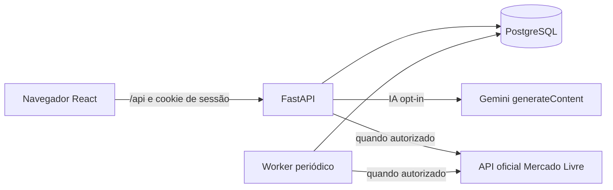

# Arquitetura

## Referência de design e implementação

O Figma é a referência visual principal de UI/UX. O Codex interpreta os designs e
implementa na stack existente, reutilizando componentes e tokens, seguido de
validação visual. O [guia frontend](apps/frontend.md#fluxo-oficial-de-design--figma)
concentra o procedimento e o fallback por exportações. Essa consulta não é uma
dependência de runtime da SPA, API, worker ou banco.

Paper Bridge foi descontinuada na spec 0039. O pacote e seus gates
exclusivos foram retirados; a arquitetura da aplicação permanece preservada.
O MCP oficial do Paper permanece configurado para uso eventual quando
necessário, sem reativar a Bridge ou substituir o Figma como referência principal.
As specs 0035–0037 mantêm as evidências históricas, e o
[código anterior à retirada](https://github.com/SamiaLuvanice/bestprice/tree/3f230793e6699f16e8443ecad045dc1d13ba3304/tools/paper-bridge)
pode ser consultado no Git. Esses registros não orientam novas automações.

## Estado desta branch

A aplicação combina SPA React, API FastAPI, PostgreSQL 17 e um processo worker. A spec 0034 acrescenta assistência de compras por conversa, comparação manual de 2–3 produtos e histórico privado por 90 dias. O monitoramento usa publicações do Mercado Livre Brasil (MLB) e mantém seu gate externo desligado. A [visão do produto](product-context.md) adota o Mercado Livre Brasil como marketplace exclusivo desta fase, substituindo a premissa Amazon anterior; o acesso real a anúncios de terceiros do Mercado Livre ainda depende de validação externa.

A SPA consome rotas de sessão, dashboard, monitoramentos, histórico, alertas e notificações por `frontend/src/api.ts`. FastAPI isola autenticação em `app/auth`, consulta externa em `app/marketplace`, regras e persistência em `app/products`, seleção periódica em `app/monitoring` e pesquisas privadas em `app/research`. O cliente tipado `features/research/api.ts` usa o mesmo cookie e helpers HTTP; respostas da IA são texto não verificado, sem execução de HTML ou busca externa. O produto é compartilhado pelo identificador da publicação; cada usuário tem seu vínculo e alerta. A migration Alembic prepara o esquema antes de iniciar a API no Compose.

Na interface, `BrowserRouter` mantém `/` pública mesmo com sessão válida. `/app`
redireciona para `/app/dashboard`; assistente, comparador e histórico ficam em
`/app/assistant`, `/app/compare` e `/app/history`, com IDs nas URLs dos recursos
salvos. `App.tsx` valida a sessão antes da área protegida. `/app/monitoring` abre a
lista, `/app/monitoring/overview` preserva o painel e `/app/monitoring/alerts` os
alertas; `/produtos`, `/produtos/:id` e `/alertas` continuam funcionais. A API valida
propriedade e expiração em cada operação. O retorno do login aceita apenas caminhos
internos conhecidos; o estado da área é isolado por usuário e desmontado no logout
ou 401, com revalidação ao restaurar uma página pelo histórico. Nginx resolve
caminhos da SPA por `index.html` e reserva `/api/*` ao proxy. A revisão 0034 foi
verificada localmente, sem deploy.

A spec 0027 aplica o redesign aprovado às telas públicas e autenticadas usando
Tailwind CSS v4 e componentes shadcn/ui locais em `frontend/src/components/ui/`.
`components.json`, o alias `@/` e `src/lib/utils.ts` mantêm a geração e combinação
das classes; os tokens continuam sendo da identidade BestPrice. A landing atual da 0034 comunica assistência e comparação sem prometer ofertas;
a arte local é ilustrativa e os CTAs protegidos passam pelo login quando necessário. O detalhe carrega
Recharts e Chart do shadcn sob demanda, desenha apenas histórico já carregado e
oferece tooltip decimal exato e tabela textual. Na 0027, nenhuma regra monetária,
rota HTTP ou persistência foi alterada. A [verificação da 0027](../specs/0027-redesign-figma-shadcn/verification.md)
registra os gates locais e a referência SVG usada quando o conector Figma falhou;
implantação dessa mudança ainda não foi verificada.

Uma URL MLB e os vínculos já persistidos são resolvidos antes de construir o cliente externo. URL inválida ou de formato não suportado, duplicação, retomada, `Retry-After` vigente, backoff, intervalo mínimo e `not_found` recente são decididos localmente, tanto no cadastro quanto na atualização; só uma consulta necessária à publicação exige a integração. Cada consulta é serializada por publicação com trava advisory PostgreSQL em conexão própria, e a transação de leitura é confirmada antes da chamada HTTP externa. O cliente real requer `MERCADOLIVRE_THIRD_PARTY_VALIDATED=true`, variáveis OAuth configuradas e a conta operadora provisionada no banco. A configuração padrão mantém consultas externas inativas. O fluxo `authorize_operator` cria uma URL oficial com `state` assinado e prazo curto; o callback valida o estado e o redirect URI exato, troca o código e grava tokens cifrados. Em Stage, o callback público pertence à API Render e grava no banco Stage; sua rota só fica disponível após promoção/deploy, e o DevCenter deve registrar o mesmo HTTPS. Access e refresh tokens são cifrados com a chave do ambiente; API e worker usam o mesmo registro e serializam a renovação por trava PostgreSQL. Resposta ambígua de refresh bloqueia nova tentativa até reprovisionamento, e 429 adia nova tentativa conforme `Retry-After`. A autorização inicial e a persistência cifrada foram comprovadas na evidência Stage; renovação real e acesso a anúncios de terceiros continuam pendentes. O cliente aceita apenas um preço comparável entre usuários: preço restrito a comprador, variações com preços divergentes ou preço de variação diferente do `amount`/`regular_amount` resultam em `unsupported_price_context` sem gravar preço (regras em [backend.md](apps/backend.md)). Falhas de consulta, inclusive na obtenção do token OAuth, registram a tentativa sem apagar o preço anterior. O worker verifica a configuração ao iniciar cada ciclo e consulta apenas produtos com vínculo ativo e horário vencido; pula a publicação já em consulta e isola exceções inesperadas de cada publicação, registrando a falha sem interromper o ciclo nem sobrescrever um sucesso mais recente. O lote e a concorrência têm limites configuráveis; publicações diferentes em paralelo usam sessões de banco independentes. Sucesso agenda nova consulta pela cadência configurada; erro temporário preserva a última observação e agenda backoff exponencial com jitter de 20%, respeitando `Retry-After`. Após `not_found`, uma falha transitória mantém esse estado e o intervalo mínimo de 24 horas; uma nova confirmação de `not_found` zera os contadores de falha. A janela configurada de frescor determina reuso do preço, o campo `stale` e a elegibilidade do preço para alertas; preço vencido deixa a condição `unknown` e não gera notificação.

| Configuração | Uso |
|---|---|
| `POSTGRES_DB`, `POSTGRES_USER`, `POSTGRES_PASSWORD` | Banco Compose |
| `DATABASE_URL` ou `DB_HOST`, `DB_NAME`, `DB_USER`, `DB_PASSWORD`, `DB_PORT` | Conexão API, worker e Alembic |
| `BACKEND_PORT`, `FRONTEND_PORT`, `DB_PORT` | Portas locais do Compose |
| `MERCADOLIVRE_THIRD_PARTY_VALIDATED` | Liberação explícita após validar acesso a terceiros; padrão `false` |
| `MERCADOLIVRE_CLIENT_ID`, `MERCADOLIVRE_CLIENT_SECRET`, `MERCADOLIVRE_OAUTH_KEY` | Cliente OAuth e chave Fernet da conta operadora; segredos somente no ambiente |
| `MERCADOLIVRE_REDIRECT_URI` | Redirect URI HTTPS registrado no DevCenter; em Stage aponta ao callback Render |
| `MERCADOLIVRE_VALIDATION_PRICE_ITEM_ID`, `MERCADOLIVRE_VALIDATION_NO_PRICE_ITEM_ID`, `MERCADOLIVRE_VALIDATION_UNAVAILABLE_ITEM_ID` | IDs MLB distintos e autorizados para a sonda manual somente de leitura; vazios por padrão |
| `APP_ENV` | Cookie Secure quando igual a `stage` ou `production` |
| `API_ORIGIN` | Origem HTTPS da API Render usada apenas pela Pages Function de stage; não é segredo nem entra na SPA |
| `MONITOR_CHECK_INTERVAL_SECONDS`, `MONITOR_FRESHNESS_SECONDS` | Cadência após sucesso e janela de frescor, ambas com padrão de 3600 segundos e faixa de 60 a 86400 |
| `MONITOR_BATCH_LIMIT`, `MONITOR_MAX_CONCURRENCY` | Publicações por ciclo (padrão 20, faixa 1 a 100) e tentativas paralelas (padrão 1, faixa 1 a 16) |
| `MONITOR_POLL_INTERVAL_SECONDS` | Pausa entre ciclos (padrão 60 segundos, faixa 1 a 3600) |
| `AI_ENABLED`, `GEMINI_API_KEY` | Opt-in e chave Google somente backend; padrões `false` e vazio, modelo fixo `gemini-3.5-flash-lite` |
| `API_PROXY_TARGET` | Destino do proxy Vite em desenvolvimento; padrão `http://localhost:8000` |
| `TEST_DATABASE_URL` | Banco isolado dos testes de integração |

O módulo `app/research` separa rotas, schemas, serviço, repositório, serialização,
configuração e adapter Google. As seis tabelas novas são privadas e não compartilham
produtos com o monitoramento. Dinheiro original da comparação fica em tabela filha,
`NUMERIC(18,2)` nullable/`Decimal`; JSON guarda apenas análise e snapshots REST.
Reserva de idempotência e cotas usa transação curta PostgreSQL, liberada antes do
HTTP. O contexto é capturado sob trava; conclusão revalida expiração, exclusão e
versão antes de salvar. O lifespan da API agenda limpeza horária em thread, sem
bloquear startup/health; pesquisas vencidas já são negadas pelas consultas.
Veja [banco](database.md) e [backend](apps/backend.md#assistência-e-pesquisas-privadas--spec-0034).

O adapter usa host Google fixo, timeout de 25 s e nenhum redirect, retry automático
ou ferramenta de busca. Nginx local permite leitura de 35 s somente em chat/analyze,
conservando 5 s no restante. Sem opt-in e chave, geração retorna indisponibilidade;
comparações e pesquisas salvas continuam acessíveis. A configuração gratuita e a
qualidade do modelo real permanecem pendentes; o app não audita billing Google.

O Compose inicia DB, executa Alembic no backend, aguarda seu health check e inicia worker e frontend. A spec 0018 configura outra topologia: navegador → Cloudflare Pages/Function em `/api/*` → API Render → PostgreSQL Supabase exclusivo de stage. O Blueprint chama um script que executa Alembic antes de Uvicorn e usa `/api/health` como health check. O proxy mantém as chamadas e o cookie na origem da interface. Após a promoção #69, API e proxy públicos responderam health 200 com banco `ok`; login via Pages emitiu cookie `Secure` e `HttpOnly`. A migration `20261014rls` protege as dez tabelas `public` do Supabase de stage sem políticas de acesso direto. Uma pausa controlada do banco fez a API retornar 503; Events do Render registrou health check 503, seguido de 502 na borda. O restore recuperou o serviço. O worker não integra essa topologia. GitHub Actions valida o código e publica imagens após o fluxo de release. Consulte os guias de [backend](apps/backend.md), [frontend](apps/frontend.md), [banco](database.md) e [infraestrutura](apps/infraestrutura.md).
